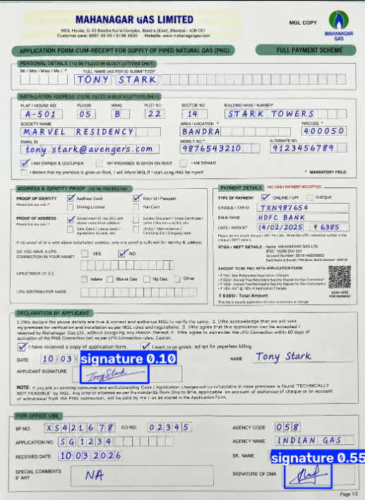

## Used by the MA CRM as `RAPIDOCR_BASE_URL`

This copy adds one extra endpoint, `POST /extract-text-generic`, on top of the original
service below: a template-free whole-page OCR pass (no `document_type`, no ROI boxes —
the rest of this service only works for one fixed, pre-calibrated form layout). It runs
RapidOCR over the full image and returns the detected text in reading order, so it works
on screenshots whose layout isn't known in advance (courier/COD parcel labels, which vary
by courier and by handwriting). The CRM's `rapidocr-provider.js` calls this endpoint, then
runs its own regex field-guessing over the returned text — this service does no
parcel-specific field parsing itself.

**Run this as its own process** (`uvicorn app.main:app --host 0.0.0.0 --port 8000`, or
the included `Dockerfile`/`compose.yaml`). It is Python/FastAPI; the CRM (`server.js`) is
Node and only talks to it over HTTP via `RAPIDOCR_BASE_URL` in `.env` — on Render that
means a second Web Service, pointed at from the CRM's environment variables. Running it
locally alongside the CRM for development is just `RAPIDOCR_BASE_URL=http://127.0.0.1:8000`.

In the CRM's extraction order: **RapidOCR is tried first** (its own 20s timeout,
`RAPIDOCR_TIMEOUT_MS`), then Gemini/NVIDIA if it fails or times out — the whole chain for
one screenshot is capped at 30 seconds total, after which the CRM gives up and leaves the
field blank for manual entry rather than waiting further.

---

# Banking/Utility Form Extraction Service

A CPU-friendly FastAPI microservice that reads a scanned/photographed form and returns:

1. **OCR field extraction** — printed + handwritten field values, cleaned and validated with regex
2. **Signature detection** — presence, confidence, and bounding box for every signature on the page (a page can have more than one)

Currently ships one calibrated document template: the **Mahanagar Gas "Application Form-cum-Receipt for Supply of PNG"**. Adding another form type means calibrating a new template the same way (see [Adding a new document template](#adding-a-new-document-template)).

## Demo



Both signatures on this form — the applicant's and the office-use "DMA" signature — detected and boxed by the trained `yolo11n` model, each with its own confidence score. (Test image is AI-generated with fictional data — no real personal information.)

## How it works

```
                 POST /extract  (multipart: file + form fields)
                                │
                                ▼
                     Input validation / load
                                │
                     PDF/image → single page image   (PyMuPDF)
                                │
                ┌───────────────┴────────────────┐
                ▼                                 ▼
        RapidOCR — once per page          Signature zone(s) known?
        (detection + recognition)              │           │
                │                              yes          no
                ▼                               │           │
        map boxes → field ROIs           crop zone    YOLO11 detects
                │                               │      bbox(es) on page
     whole-page regex fallback                  │           │
     for fields OCR missed                       └─────┬─────┘
     (app/pipeline/ocr/text_extractor.py)               ▼
                │                              OpenCV ink-analysis
                ▼                            (presence/confidence)
          field text map                            │
                └───────────────┬───────────────────────┘
                                ▼
                          JSON response
```

- **OCR engine**: [RapidOCR](https://github.com/RapidAI/RapidOCR) (ONNX, CPU). `trocr` (Microsoft's handwriting model) and a `hybrid` mode also exist but underperform badly on this form's boxed/segmented handwriting style — see [OCR engine comparison](#ocr-engine-comparison).
- **Signature detection**: known templates check fixed, hand-calibrated pixel regions directly (fast, no model needed). Unknown templates fall back to a trained YOLO11 detector.
- **Field validation**: `app/pipeline/fields_regex.py` — per-field regex patterns (mobile number, PIN code, email, dates, alphanumeric codes) plus common OCR digit-confusion fixes (O↔0, S↔5, etc.), referencing the field types actually present on this form.

## API

Base URL: `http://127.0.0.1:8000` (or wherever you deploy it). All endpoints except `/health` take `multipart/form-data`.

### `GET /health`

```json
{"status": "ok"}
```

### `POST /extract-text`

OCR field extraction only.

| Field | Type | Default | Notes |
|---|---|---|---|
| `file` | file | — | required |
| `document_type` | text | `mgl_png_form` | selects the template |
| `ocr_engine` | text | `rapidocr` | `rapidocr` \| `trocr` \| `hybrid` |
| `roi_overrides` | text (JSON) | — | optional, e.g. `{"full_name": {"x1":0,"y1":0,"x2":100,"y2":50}}` |

```json
{
  "document_type": "mgl_png_form",
  "ocr_engine_used": "rapidocr",
  "fields": { "full_name": "PRASHANT BHIVSANE", "mobile_no": "8432056719", "...": "..." },
  "field_valid": { "full_name": true, "mobile_no": true, "...": true },
  "timing_ms": { "preprocess_ms": 9.6, "ocr_ms": 1366.7, "total_ms": 1376.3 }
}
```

### `POST /detect-signature`

Signature presence + bounding box only, no OCR.

| Field | Type | Default | Notes |
|---|---|---|---|
| `file` | file | — | required |
| `document_type` | text | `mgl_png_form` | selects the template |
| `signature_model` | text | `yolo11n` | `yolo11n` \| `yolo11s` — only consulted if the template has no fixed signature zones |
| `roi_overrides` | text (JSON) | — | optional, e.g. `{"applicant": {"x1":525,"y1":555,"x2":640,"y2":593}}` |

```json
{
  "document_type": "mgl_png_form",
  "signatures": {
    "applicant": { "present": true, "confidence": 1.0, "bbox": {"x1":525,"y1":555,"x2":640,"y2":593}, "model_used": null },
    "dma":       { "present": true, "confidence": 1.0, "bbox": {"x1":490,"y1":775,"x2":640,"y2":845}, "model_used": null }
  },
  "timing_ms": { "preprocess_ms": 9.6, "signature_detection_ms": 0.02, "opencv_ms": 0.6, "total_ms": 10.2 }
}
```

### `POST /extract` (combined)

Both of the above in one call — same request fields as the two endpoints combined, response is the union of both bodies (`fields`, `field_valid`, `signatures`, `timing_ms`).

## Setup

```
python -m venv .venv
.venv\Scripts\activate          # Windows
pip install -r requirements.txt
uvicorn app.main:app --host 127.0.0.1 --port 8000
```

Or with Docker/Podman:

```
docker build -t form-extraction-service .
docker run -p 8000:8000 form-extraction-service
```

Or with compose (either tool — `compose.yaml` mounts `models/` read-only so you can swap in a retrained model without rebuilding):

```
podman compose up --build
# or: docker compose up --build
```

## Accuracy

### Signature detection — YOLO11n

Trained on [SignverOD](https://www.kaggle.com/datasets/victordibia/signverod) (Victor Dibia, 2021 — 2765 document images, filtered to the `signature` class only), 100 epochs on a Colab T4 GPU (~3.8 hours), evaluated on the held-out test split (354 images):

| Metric | Value |
|---|---:|
| Precision | 0.943 |
| Recall | 0.772 |
| mAP50 | 0.816 |
| mAP50-95 | 0.490 |
| Inference speed (GPU) | 3.3 ms/image |
| Dataset split | 1513 train / 266 val / 354 test |

**Real-world finding worth flagging**: on this project's own test forms, the default confidence threshold (`0.25`) reliably catches signatures near a printed line/box (e.g. the office-use "DMA" signature, confidence 0.48–0.55) but missed a more loosely-placed cursive signature until the threshold was lowered — it showed up at confidence **0.10**, correctly boxed, with only one low-value false positive (~0.04) appearing at that lower threshold. This suggests `0.25` may be conservative for freeform cursive signatures specifically. Only tested on 2 real samples so far — needs validation against more signed/unsigned scans before changing the production default (currently in `app/config.py` / `app/pipeline/signature/detector.py`).

For this project's own document template (`mgl_png_form`), signature detection in production actually uses **fixed calibrated ROIs + OpenCV ink-analysis**, not YOLO — the two signature zones (`applicant`, `dma`) are at known fixed positions, so YOLO is only the fallback for a document type with no calibrated template.

### OCR field extraction — RapidOCR

**22 of 23 fields** extract correctly on the real test scan, verified against the source form:

| Field | Result |
|---|---|
| `flat_house_no`, `floor`, `wing`, `plot_no`, `sector_no`, `building_name`, `society_name`, `area_location`, `pincode`, `mobile_no`, `payment_txn_id`, `bank_name`, `declaration_date`, `bp_no`, `co_no`, `agency_code`, `agency_name`, `full_name`, `special_comments` | ✅ Correct |
| `date_amount` | ⚠️ Date correct, amount digit occasionally misread |
| `applicant_name_written`, `received_date` | ⚠️ Partially correct (a character or word sometimes dropped) |
| `email` | ❌ `@` and `.` are OCR'd as mojibake at this scan resolution — a character-recognition limitation, not fixable by more regex work |

### OCR engine comparison

Tested on the same real form. **RapidOCR is the clear winner** — both alternatives were tested because they're theoretically handwriting-capable, but neither generalizes to this form's *segmented, boxed* handwriting style (one character per printed box), as opposed to natural flowing handwriting:

| Engine | Valid fields | Time (CPU) | Notes |
|---|---:|---:|---|
| **RapidOCR** | 22/23 | ~2-10s | Default. Best fit for boxed/segmented handwriting. |
| TrOCR (`microsoft/trocr-base-handwritten`) | fails badly | ~80s | Trained on natural cursive sentences (IAM dataset); hallucinates fluent English on boxed characters it's never seen the shape of. |
| EasyOCR | 13/23 (several "valid" ones are wrong, e.g. mobile number one digit off) | ~13s | Different detector/recognizer stack, still meaningfully worse than RapidOCR on this form. Removed from the codebase after testing. |

## Project structure

```
Dockerfile / compose.yaml     Container build + podman/docker compose service definition
app/
  main.py                     FastAPI app: /health, /extract-text, /detect-signature, /extract
  config.py                   Settings: default engine/model, trained-weight paths
  schemas.py                  Pydantic request/response models
  templates.py                Document templates: field ROIs + signature zones
  pipeline/
    preprocess.py              PDF/image loading, page normalization
    fields_regex.py            Per-field regex validation + OCR-error correction
    ocr/
      rapidocr_engine.py        Whole-page RapidOCR (ROI-filtered recognition for speed)
      trocr_engine.py            Per-crop TrOCR recognition
      router.py                 Dispatches by ocr_engine
      text_extractor.py          Whole-page-text regex fallback
    signature/
      detector.py                YOLO11 wrapper
      ink_analysis.py             OpenCV presence scoring
      service.py                  Combines fixed zones / YOLO + ink-analysis
training/
  data/prepare_signverod.py   SignverOD -> YOLO dataset converter
  train_signature.py          CLI: train yolo11n or yolo11s
  evaluate.py                  Compare trained runs
  colab_train_signature.ipynb GPU training notebook (writes checkpoints to Drive)
  visualize_detections.py     Draw raw YOLO detections on an image
  visualize_signature_zones.py Draw a template's fixed signature zones + ink-analysis result
validation/
  run_e2e_validation.py       Document-level signed/unsigned accuracy against your own scans
  signed/ unsigned/            Your own test scans (gitignored — see below)
```

## Adding a new document template

1. Get a real sample scan of the new form.
2. Calibrate field + signature-zone pixel ROIs against it (crop-and-view iteratively; see `app/templates.py`'s `mgl_png_form` entry for the pattern).
3. Add any field-specific regex validation to `app/pipeline/fields_regex.py` if the new form has fields with a distinctive shape (dates, codes, amounts).
4. Test via `/extract` and refine ROIs against the actual output.

## Notes on data handling

- `validation/signed/`, `validation/unsigned/`, and `raw_text.txt` are gitignored — they contain or are derived from a real person's personal data (name, address, mobile, email, bank details) and must never be committed.
- `training/data/signverod_yolo/` (the converted training dataset) and `models/signature/*/` (trained weights) are also gitignored — regenerate via `training/data/prepare_signverod.py` and the training scripts/notebook rather than committing large binaries.
